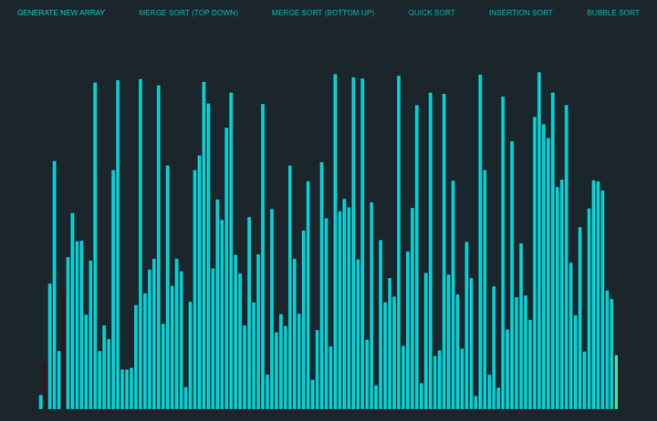

# Sorting Algorithm Visualizer

An interactive React app that animates how classic sorting algorithms work, one comparison and swap at a time.

**Live demo:** https://pranavsangani.github.io/SortingAlgorithmVisualizer/



## Algorithms

| Algorithm | Approach | Average time |
|---|---|---|
| Merge Sort (Top Down) | Recursively splits the array in half, then merges the sorted halves | O(n log n) |
| Merge Sort (Bottom Up) | Merges runs of size 1, 2, 4, … iteratively, with no recursion | O(n log n) |
| Quick Sort | Partitions around a pivot (the last element), then sorts each side | O(n log n) |
| Insertion Sort | Grows a sorted prefix by inserting each element into place | O(n²) |
| Bubble Sort | Repeatedly swaps adjacent elements that are out of order | O(n²) |

## How to use

1. Click **Generate New Array** for a fresh set of 128 random bars.
2. Pick an algorithm. The other buttons are disabled until the sort finishes.
3. Watch the colors:
   - **Turquoise:** not yet sorted
   - **Red:** being compared or moved
   - **Yellow:** the current pivot (Quick Sort)
   - **Green:** in its final sorted position

## Built with

React, JavaScript, HTML and CSS. Each algorithm lives in its own file under [`src/SortingAlgorithms/`](src/SortingAlgorithms) and animates the bars directly as it runs.

## Run it locally

```bash
git clone https://github.com/PranavSangani/SortingAlgorithmVisualizer.git
cd SortingAlgorithmVisualizer
npm install
npm start
```

The app opens at http://localhost:3000. `npm run deploy` builds it and publishes it to GitHub Pages.

---

Made by [Pranav Sangani](https://pranavsangani.online).
